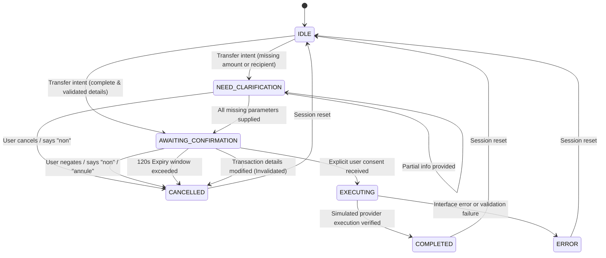

# MBOFLOW — FINANCIAL TRANSACTION LIFECYCLE SPECIFICATION

**Document Version:** 1.0.0  
**Classification:** Operational Security & Architecture Standard  
**System Name:** MboFlow Financial Accessibility Platform  
**Target Environment:** SAFINUM Innovate Challenge (Controlled Simulation)  

---

## 1. The 12-Step Controlled Simulated Transaction Lifecycle

Every financial interaction within MboFlow must strictly traverse the twelve distinct phases of the financial interaction lifecycle. No step may be bypassed, re-ordered, or executed autonomously without explicit verification.

```
 [1. USER REQUEST] ────────► [2. INTENT CLASSIFICATION] ────────► [3. INTERFACE INSPECTION]
                                                                          │
 ┌────────────────────────────────────────────────────────────────────────┘
 ▼
 [4. ENTITY EXTRACTION] ────► [5. DETERMINISTIC VALIDATION] ───► [6. VERNACULAR EXPLANATION]
                                                                          │
 ┌────────────────────────────────────────────────────────────────────────┘
 ▼
 [7. DETAILS PRESENTATION] ─► [8. EXPLICIT CONFIRMATION] ──────► [9. SIMULATED DISPATCH]
                                                                          │
 ┌────────────────────────────────────────────────────────────────────────┘
 ▼
 [10. RESULT VERIFICATION] ─► [11. OUTCOME EXPLANATION] ───────► [12. TAMPER-EVIDENT AUDIT]
```

### Detailed Lifecycle Stages

| Step | Phase Name | Execution Context | System Behavior & Invariants |
| :---: | :--- | :--- | :--- |
| **1** | **User Request Received** | Voice Gateway / REST API | User speaks or sends command in any supported Cameroonian or official language. Audio is transcoded to 16 kHz mono WAV. |
| **2** | **Intent Interpretation** | Natural Language Intelligence | Intent classified into structured `AgentIntent` (`CHECK_BALANCE`, `EXPLAIN_FEES`, `PREPARE_TRANSFER`, `CONFIRM_TRANSFER`, `CANCEL_TRANSFER`, etc.). Negations are checked first. |
| **3** | **Interface Inspection** | Playwright Browser Connector | Active interface DOM is inspected non-invasively. SSRF validation ensures navigation is strictly within authorized boundaries. |
| **4** | **Financial Extraction** | DOM & Accessibility Extractor | Balances, fees, warnings, conditions, and interactive selectors are extracted from DOM leaf nodes. Unseen messages are captured. |
| **5** | **Deterministic Validation** | Financial Integrity Engine | Non-LLM mathematical verification: $\text{Total} \equiv \text{Amount} + \text{Fee}$. Amounts, currencies, and phone numbers are deterministically shielded. |
| **6** | **Vernacular Explanation** | Multilingual Translation Engine| User receives a contextual explanation in their selected language. All monetary numbers and identifiers are preserved without alteration. |
| **7** | **Details Presentation** | Action Guard (Phase 1) | Transaction prepared with status `PENDING_CONFIRMATION`. Full summary presented: beneficiary, account, amount, fee, total debit, conditions, warnings, and simulation badge. Cryptographic HMAC-SHA256 signature calculated. 120s TTL initiated. |
| **8** | **Explicit Authorization** | State Machine & Action Guard | System waits for explicit user affirmative consent ("Oui je confirme"). If user cancels ("Non", "Annule"), transaction is marked `CANCELLED`. If details change, previous authorization is invalidated. Generic "yes" outside pending confirmation is rejected. |
| **9** | **Simulated Execution** | Action Guard & Provider Router | Re-verifies HMAC signature, checks expiration ($t \le \text{expires\_at}$), re-verifies arithmetic, acquires concurrency lock, and submits form to simulated banking portal or sandbox ledger. |
| **10** | **Result Verification** | Browser Connector & Extractor | Browser DOM is re-inspected to verify that transaction was accepted by the interface and that no unexpected error modals appeared. |
| **11** | **Outcome Explanation** | Agent Orchestrator & TTS | Spoken or visual confirmation presented to user in their language with verified transaction reference ID and remaining balance. |
| **12** | **Tamper-Evident Audit** | Storage Repository (SQLite WAL) | Complete event logged in append-only audit database with correlation ID, session ID, timestamp, and PII-masked payload (`699***122`, `CM2110...0123`). |

---

## 2. Finite State Machine Specification (`DialogState`)



---

## 3. Mandatory Confirmation Requirements

Before any simulated debit or transfer can proceed to execution, the user must be presented with:
1. **Beneficiary Name:** (e.g. `Destinataire (699***122)` or contact name).
2. **Beneficiary Identifier:** Exact phone number or account number.
3. **Exact Amount:** Specified with currency (e.g. `25 000 FCFA`).
4. **Currency:** Standard CEMAC notation (`FCFA` or `XAF`).
5. **Applicable Fees:** Authoritative fee extracted from DOM or provider tariff schedule (e.g. `250 FCFA`). Never guessed.
6. **Total Debit:** Exact arithmetic sum ($\text{Amount} + \text{Fee} = 25\,250\text{ FCFA}$).
7. **Conditions:** Execution delays, cancellation policies, and simulation notices.
8. **Security Warnings:** Explicit cautions (e.g. *"Ne partagez jamais votre code secret PIN"*).
9. **Simulation Badge:** `[OPÉRATION SIMULÉE - DÉFI SAFINUM]`.

---

## 4. Cryptographic Detail Binding & Tamper Invalidation

### Cryptographic Invariant
Every prepared transaction is bound by an HMAC-SHA256 signature:
$$\text{Signature} = \text{HMAC-SHA256}(K_{\text{secret}}, \text{tx\_id} \parallel \text{source} \parallel \text{dest} \parallel \text{amount} \parallel \text{fee} \parallel \text{total} \parallel \text{currency} \parallel \text{expires\_at})$$

### Detail Modification Handling
If the user modifies any transaction parameter after preparation:
1. `action_guard.invalidate_transaction(tx_id, reason)` is triggered immediately.
2. The old transaction is marked `CANCELLED`.
3. The previous cryptographic authorization is nullified.
4. A brand new transaction object is prepared with a fresh `transaction_id`, fresh HMAC signature, and fresh 120-second validity window.
5. A generic affirmative response ("oui") received after parameter alteration is strictly rejected until the user authorizes the new transaction.

