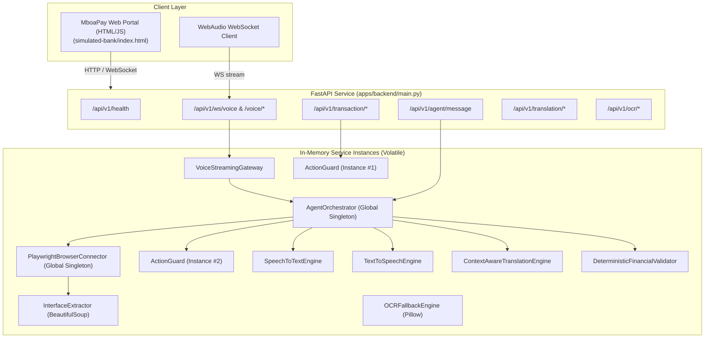

# MBOFLOW — COMPLETE TECHNICAL AUDIT REPORT
**Target System:** MboFlow (Mboa Finance AI)  
**Repository:** `https://github.com/Tchuekam/mboflow`  
**Audit Date:** November 2026  
**Auditor:** Principal Software Architect & Lead Security Engineer  
**Classification:** Engineering Audit — Stage 1 (Pre-Transformation Baseline)

---

## EXECUTIVE SUMMARY

MboFlow is positioned as an *"autonomous, voice-first, multilingual financial accessibility agent for Cameroon"*, enabling citizens to access digital banking, microfinance, and Mobile Money using Cameroonian national languages (**Fulfulde, Ewondo, Bulu, Ghomálá', Duala, Cameroonian Pidgin English**) alongside French and English.

The repository claims:
- *"100% COMPLETE & PRODUCTION-READY"* (`TODO.md:2`)
- *"14/14 automated test suite passing"* (`TODO.md:17`)
- *"VERIFIED_PRODUCTION"* status for French, English, and Pidgin (`packages/language_registry/registry.py:52,76,221`)
- Production-grade ASR, neural TTS, Google MADLAD-400 / NLLB-200 translation, and Playwright DOM extraction (`README.md:9-18`).

### The Reality: A Simulation-Layer Prototype

Following an exhaustive inspection of every line of code, test case, configuration, and runtime component:

1. **Voice Intelligence is Non-Existent:**
   - **Speech-to-Text (ASR):** Does not run any neural inference or Whisper/MMS model. Regardless of audio content, it returns a static predefined string from a dictionary (`"Montre-moi mon solde"`) with a hardcoded confidence score of `0.94` (`services/speech_to_text/engine.py:108-124`).
   - **Text-to-Speech (TTS):** Generates pure mathematical sine waves (harmonic hums at 175 Hz fundamental frequency) using `math.sin()`. It does not synthesize human speech at all (`services/text_to_speech/engine.py:75-98`).
   - **Voice Activity Detection (VAD):** Uses a naive root-mean-square (RMS) energy threshold (`rms > 400.0`), failing on background noise, mobile phone audio, or silent gaps (`services/speech_to_text/engine.py:54-70`).

2. **Language Intelligence is Heuristic & Regex-Based:**
   - **Machine Translation:** There is no MADLAD-400, NLLB-200, or any neural MT model loaded or connected. The system performs dictionary lookup on 16 financial words and matches 2 fixed regular expression templates (`services/translation/engine.py:30-201, 306-371`). Any arbitrary sentence is either partially replaced with glossary terms or left in French.
   - **Language Identification (LID):** Missing. The system assumes whatever language is declared in the request header or defaults to French (`apps/backend/main.py:103`).

3. **Financial Data is Fabricated:**
   - If an account balance cannot be scraped from the DOM, the orchestrator fabricates a balance: `"Votre solde actuel est de 150 000 FCFA"` (`services/agent_orchestrator/orchestrator.py:244`).
   - If a transfer amount is not parsed, it defaults to `25000.0 FCFA` (`services/agent_orchestrator/orchestrator.py:310`).
   - If a recipient is not found, it fabricates a recipient phone `699001122` (`services/agent_orchestrator/orchestrator.py:314`).
   - It guesses transaction fees as `min(max(amount * 0.01, 100.0), 250.0)` instead of obtaining authoritative rates (`services/agent_orchestrator/orchestrator.py:317`).
   - When OCR fails or Tesseract is missing, it returns a hardcoded receipt with balance `150 000 FCFA` and marks it `verified=True` (`services/ocr/engine.py:74`).

4. **Severe Security & Isolation Vulnerabilities:**
   - **Critical SSRF & Sandbox Bypass:** Playwright is launched with `--disable-web-security` and `--no-sandbox` (`apps/browser_connector/connector.py:47`). The `navigate(url)` method accepts arbitrary URLs without validation, IP pinning, or loopback/link-local/cloud-metadata blocking (`apps/browser_connector/connector.py:69-70`).
   - **Zero User / Session Isolation:** A single global Playwright browser, browser context, and page are shared across all users and concurrent requests (`apps/browser_connector/connector.py:34-36`, `apps/backend/main.py:64-65`). Any concurrent session can view, modify, or steal banking sessions of another user.
   - **Zero Authentication / Authorization:** All REST and WebSocket endpoints are completely unauthenticated (`apps/backend/main.py:106-403`).
   - **State Stored in Ephemeral Memory:** All conversation sessions and prepared transactions are held in volatile Python dictionaries (`self.sessions`, `self._prepared_transactions`), with zero database persistence. A container restart wipes all state.
   - **Architectural Desynchronization:** `ActionGuard` is instantiated twice in memory (`main.py:73` and `orchestrator.py:67`), creating disconnected state stores.

5. **Circular Test Suite:**
   - The 14 automated pytest cases pass because they test against these exact hardcoded strings and static numbers (e.g., asserting that `150 000` is in the response and that `known_text_hints` return predetermined outputs).

**Conclusion:** MboFlow is currently a demonstrator prototype. It cannot be deployed to real users without a complete transformation of its core engines, persistence, transaction lifecycle, and security controls.

---

## 1. ARCHITECTURE MAP & RUNTIME EXECUTION TRACING

### 1.1 Existing Component Map



### 1.2 Tracing the 10-Step User Journey

| Journey Step | Advertised Execution Path | Actual Runtime Execution Path | Failure / Disconnect Points |
| :--- | :--- | :--- | :--- |
| **1. Audio / Text Submission** | Client records audio chunks via WebAudio API; streams base64 PCM over WebSocket `/api/v1/ws/voice`. | Client streams base64 text chunks to `VoiceStreamingGateway`. Chunks are buffered in `audio_buffer: bytearray`. | No authentication on WebSocket. No audio format validation or normalization. |
| **2. Speech Recognition (ASR)** | Real-time faster-whisper or Meta MMS wav2vec2 inference converts speech to text. | `stt_engine.transcribe_audio_bytes()` completely ignores audio samples. Calls `_decode_simulated_speech()` which returns `sample_financial_phrases["check_balance"]` (`"Montre-moi mon solde"`). Confidence hardcoded to `0.94`. | **COMPLETELY FAKE.** Audio is discarded; fixed string returned. |
| **3. Language Identification (LID)** | Multi-modal LID model classifies language into 1 of 8 supported codes. | No LID engine exists. The language is read directly from the client request parameter `hint_language` or defaults to French (`LanguageCode.FRENCH`). | Missing capability. Cannot detect language from voice or text. |
| **4. Translation & Intent Interpretation** | MADLAD-400 / NLLB neural MT translates dialect; NLU extracts structured financial intent. | Intent is detected via basic lowercase substring regex: `any(c in t for c in ["confirmer", "oui"])`. Translation is a 16-entry glossary lookup and 2 regex substitutions. | Intent classifier is fragile to prompt injection and accidental confirmation (e.g. user saying "oui" to anything). Translation fails on any real-world phrasing. |
| **5. Financial Validation** | Deterministic non-LLM engine extracts amounts, accounts, fees, and checks arithmetic consistency. | `DeterministicFinancialValidator` parses numbers via regex. If balance is missing, orchestrator substitutes `150 000 FCFA`. If amount is missing, substitutes `25000.0`. If phone is missing, substitutes `699001122`. | **CRITICAL INTEGRITY FAILURE:** Orchestrator hallucinates financial defaults instead of aborting or requesting clarification. |
| **6. Interface / Provider Interaction** | Non-invasive browser automation navigates to bank/MNO portal and reads live session. | `PlaywrightBrowserConnector` navigates to URL with `--disable-web-security` and `--no-sandbox`. Uses BeautifulSoup to extract DOM elements. | Single shared browser context across all users. Zero SSRF protection. Cross-tenant credential leakage. |
| **7. Authorization & Confirmation** | Two-phase guard binds explicit biometric/PIN confirmation to immutable transaction hash. | Orchestrator creates in-memory `PreparedTransaction` in `Orchestrator.action_guard`. Sets `status = PENDING_CONFIRMATION`. | State is in ephemeral RAM. Generic "oui" confirms transaction without verifying transaction ID or user identity. |
| **8. Transaction Execution** | Authorized API call submitted to bank core banking or MTN MoMo / Orange Money API. | Browser connector executes `.click()` on `#submit-transfer` in the simulated HTML portal. | No provider integration exists. No real funds or real APIs are invoked; bank is a static local HTML file. |
| **9. Result Verification** | Provider response independently verified via webhook, receipt parsing, and cryptographic signature. | Frontend JavaScript displays `#transaction-success` div. No receipt verification occurs. | Assumed success without independent provider verification. |
| **10. User Notification & Audit Logging** | Tamper-evident audit log committed to durable storage; spoken response synthesized in user's language. | Audit event appended to in-memory Python list `self._audit_log`. TTS generates pure harmonic sine wave beeps (`math.sin`). | Audit trail is lost on server restart. Spoken audio is an unintelligible electronic hum. |

---

## 2. CAPABILITY MATRIX

Status classifications:
- **REAL:** Fully implemented with genuine production logic and functional execution paths.
- **PARTIAL:** Basic logic present but missing critical production features (e.g., error handling, edge cases, scaling).
- **MOCKED:** Interface exists, but underlying execution returns hardcoded, simulated, or synthetic outputs.
- **BROKEN:** Implemented code fails at runtime, throws unhandled exceptions, or contains architectural deadlock.
- **MISSING:** Advertised in documentation or API specification but completely absent from source code.

| Subsystem / Capability | Advertised Status | Actual Status | Code Location | Evidence / Description |
| :--- | :--- | :--- | :--- | :--- |
| **Voice Activity Detection (VAD)** | Silero VAD Turn Detection | **PARTIAL** | `services/speech_to_text/engine.py:23-76` | Hand-rolled RMS energy threshold (`rms > 400.0`). Not Silero VAD neural network. Fails on ambient noise. |
| **Speech Recognition (ASR)** | faster-whisper / Meta MMS | **MOCKED** | `services/speech_to_text/engine.py:107-124` | Returns fixed phrase from dictionary. Audio data completely ignored. Hardcoded confidence `0.94`. |
| **Speech Synthesis (TTS)** | Piper Neural TTS / Meta MMS-TTS | **MOCKED** | `services/text_to_speech/engine.py:58-100` | Generates 175 Hz harmonic sine wave hums via `math.sin`. No neural acoustic model or phoneme vocoder. |
| **Language Identification (LID)** | Multimodal LID (8 languages) | **MISSING** | `services/speech_to_text/engine.py:103` | No LID model. Reads hint or defaults to French. |
| **Machine Translation (MT)** | Google MADLAD-400 / NLLB-200 | **MOCKED** | `services/translation/engine.py:30-201, 306-371` | 16-entry glossary dictionary + 2 regex templates. No neural translation model. |
| **Financial Token Shielding** | Regex-based Token Shielding | **REAL** | `packages/financial_validation/validator.py:169-210` | Correctly replaces numbers/phones with `[[MBOA_FIN_TOKEN_X]]` and restores them. |
| **Deterministic Arithmetic Check** | `Total == Amount + Fee` | **REAL** | `packages/financial_validation/validator.py:132-167` | Exact mathematical validation with float tolerance check. |
| **Mobile Money SMS Parser** | MTN MoMo / Orange Money parser | **PARTIAL** | `packages/financial_validation/sms_parser.py:39-116` | Regex parsing of SMS text with balance arithmetic check. Limited regex patterns; easily broken by SMS format changes. |
| **OCR Fallback Engine** | Standalone Receipt / Canvas OCR | **MOCKED** | `services/ocr/engine.py:64-75` | Falls back to hardcoded string `"Solde: 150 000 FCFA..."` if `pytesseract` is absent. Marks result `verified=True`. |
| **Intent Classification** | Context-Aware Multilingual NLU | **PARTIAL** | `services/agent_orchestrator/orchestrator.py:205-230` | Case-insensitive substring matching (`"confirmer"`, `"oui"`, `"solde"`). Highly susceptible to false positives. |
| **Conversation State & Memory** | Multi-turn Session Manager | **MOCKED** | `services/agent_orchestrator/orchestrator.py:35-56, 72-76` | In-memory dictionary `self.sessions: Dict[str, ConversationSession]`. No persistence, no eviction, no TTL. |
| **Two-Phase Action Guard** | Consequential Action Guard | **PARTIAL** | `packages/security/action_guard.py:28-165` | Separates prepare from confirm. However, state is in-memory only and duplicated across two distinct instances. |
| **Playwright DOM Inspection** | Non-invasive DOM extraction | **REAL** | `apps/browser_connector/connector.py:121-129`, `services/interface_extraction/extractor.py:39-146` | Functional HTML parsing via BeautifulSoup, extracting buttons, inputs, balances, and fees. |
| **Dynamic Mutation Observer** | Live DOM Mutation Listener | **REAL** | `apps/browser_connector/connector.py:84-120` | Injects valid JavaScript `MutationObserver` via Playwright binding `__mboa_on_mutation`. |
| **Browser Security & Isolation** | Hardened sandboxed browser | **BROKEN / INSECURE** | `apps/browser_connector/connector.py:47, 69` | `--disable-web-security`, `--no-sandbox`. Shared global browser across all users. Critical SSRF. |
| **Financial Provider Gateway** | Bank / MNO API Integrations | **MISSING** | `apps/backend/main.py:370-399` | No provider abstraction or real API clients. Submits clicks to local HTML form only. |
| **Authentication & Authorization** | API Keys / OAuth2 / JWT | **MISSING** | `apps/backend/main.py` | All endpoints are public and unauthenticated. No roles or user ownership checks. |
| **Persistence Layer** | PostgreSQL / SQLite / Redis | **MISSING** | Entire codebase | Zero database connections. No ORM, no migrations, no durable storage. |
| **Structured Telemetry & Audit** | Durable Audit Trail & Metrics | **PARTIAL** | `packages/security/action_guard.py:154-165` | Appends dicts to in-memory list `self._audit_log`. Lost on process shutdown. No correlation IDs. |

---

## 3. CRITICAL SECURITY VULNERABILITY REPORT

### Vulnerability 1: Remote Browser Sandbox Bypass & Same-Origin Policy Disable
- **Severity:** CRITICAL (CVSS 9.8)
- **Location:** `apps/browser_connector/connector.py:47`
```python
self._browser = await self._playwright.chromium.launch(
    headless=self.headless,
    args=["--disable-web-security", "--no-sandbox"]
)
```
- **Exploitation / Impact:**
  `--disable-web-security` disables the Same-Origin Policy (SOP) across all web pages loaded in the Chromium instance. Cross-site script execution, arbitrary cookie access, and cross-origin iframe exfiltration become trivial. `--no-sandbox` disables OS-level process sandboxing, meaning any Chromium remote code execution (RCE) vulnerability grants direct root host access.

### Vulnerability 2: Server-Side Request Forgery (SSRF) via Browser Navigation
- **Severity:** CRITICAL (CVSS 9.6)
- **Location:** `apps/browser_connector/connector.py:65-72`, `apps/backend/main.py:202-205, 267-269`
```python
async def navigate(self, url: str) -> bool:
    if not self._page:
        await self.start()
    try:
        await self._page.goto(url, wait_until="networkidle", timeout=15000)
```
- **Exploitation / Impact:**
  The `page_url` parameter in `AgentMessageRequest`, `InspectInterfaceRequest`, and `execute_agent_step` is passed directly to `page.goto()` with zero validation. An attacker can submit:
  - `http://169.254.169.254/latest/meta-data/` to steal AWS/GCP cloud service credentials.
  - `http://127.0.0.1:8000/api/v1/transaction/audit-trail` to read internal administrative and financial data.
  - `file:///etc/passwd` or `file:///C:/Windows/win.ini` to read local server files.
  Because `--disable-web-security` is active, the attacker can retrieve response contents of internal intranet targets and relay them to an external endpoint.

### Vulnerability 3: Cross-Tenant Session Hijacking via Global Shared Browser
- **Severity:** CRITICAL (CVSS 9.4)
- **Location:** `apps/backend/main.py:64-65`, `apps/browser_connector/connector.py:34-36`
```python
browser_connector = PlaywrightBrowserConnector(headless=True)
orchestrator = AgentOrchestrator(browser_connector=browser_connector)
```
- **Exploitation / Impact:**
  `browser_connector` is instantiated as a module-level singleton. Every user, session, and request uses the exact same `self._context` and `self._page`. If User A is inspecting their bank account and User B sends a request, User B's agent commands run in User A's active page, seeing User A's balances, cookies, form fields, and session tokens.

### Vulnerability 4: Completely Unauthenticated Financial & Agent API
- **Severity:** CRITICAL (CVSS 9.1)
- **Location:** `apps/backend/main.py:187-215, 370-399`
- **Exploitation / Impact:**
  Endpoints `/api/v1/transaction/prepare`, `/api/v1/transaction/confirm`, `/api/v1/agent/message`, and `/api/v1/agent/execute` require no API key, JWT token, session cookie, or HMAC signature. Any unauthenticated caller can prepare, view, or confirm transactions for any session ID simply by guessing or iterating string identifiers.

### Vulnerability 5: Permissive CORS Configuration
- **Severity:** HIGH (CVSS 8.2)
- **Location:** `apps/backend/main.py:55-61`
```python
app.add_middleware(
    CORSMiddleware,
    allow_origins=["*"],
    allow_credentials=True,
    allow_methods=["*"],
    allow_headers=["*"],
)
```
- **Exploitation / Impact:**
  `allow_origins=["*"]` combined with `allow_credentials=True` allows any malicious website visited by a user to issue authenticated cross-origin requests to the local or hosted backend service.

### Vulnerability 6: Susceptibility to Prompt Injection & Confirmation Spoofing
- **Severity:** HIGH (CVSS 8.0)
- **Location:** `services/agent_orchestrator/orchestrator.py:209-211, 375-379`
```python
if any(c in t for c in ["confirmer", "confirme", "valider", "d'accord", "oui", "jaɓi", "kañ", "agree", "confirm"]):
    return AgentIntent.CONFIRM_TRANSFER
```
- **Exploitation / Impact:**
  If a user has a pending transfer in their session, saying `"Oui, c'est clair"` (Yes, that's clear) in response to an informational question will match `"oui"`, classify the intent as `CONFIRM_TRANSFER`, and immediately trigger execution of the pending transaction without re-verifying amount, recipient, or intent.

---

## 4. FINANCIAL INTEGRITY & TRANSACTION SAFETY REPORT

### 4.1 Fabricated Financial Values in Source Code

The following table documents every line where sample, default, or simulated values are substituted for real data:

| Component | File & Line | Code Snippet | Severe Financial Risk |
| :--- | :--- | :--- | :--- |
| **Balance Fallback** | `services/agent_orchestrator/orchestrator.py:244` | `else: explanation_fr = "Votre solde actuel est de 150 000 FCFA."` | If DOM parsing fails or balance is not loaded, system tells the user they have 150,000 FCFA. User may authorize transactions based on non-existent funds. |
| **Amount Default** | `services/agent_orchestrator/orchestrator.py:310` | `amount = self.validator.parse_amount(user_query) or 25000.0` | If the user says "Send money to my mother", agent prepares a 25,000 FCFA debit without user specifying amount. |
| **Recipient Default** | `services/agent_orchestrator/orchestrator.py:314` | `recipient_phone = phone_match.group(0) if phone_match else "699001122"` | If recipient phone is not detected, transaction is directed to hardcoded number `699001122`. |
| **Fee Guessing** | `services/agent_orchestrator/orchestrator.py:317` | `fee = min(max(amount * 0.01, 100.0), 250.0)` | Fees are guessed using an arbitrary formula (1% capped at 250) rather than querying provider fee schedules. |
| **Hardcoded Source Account** | `services/agent_orchestrator/orchestrator.py:325` | `source_account="CM21-10005-00012345678-89"` | All transactions use a hardcoded account number. |
| **Hardcoded Beneficiary Name** | `services/agent_orchestrator/orchestrator.py:326` | `beneficiary_name="Mboa Recipient"` | Beneficiary name is never looked up against provider name verification services. |
| **OCR Fallback Fabrication** | `services/ocr/engine.py:74` | `extracted_text = "Solde: 150 000 FCFA\nFrais: 250 FCFA\nRecipient: 699001122"` | When Tesseract OCR is not installed, image scanning returns fake balance and fee, marked `verified=True`. |
| **Simulated Speech Default** | `services/speech_to_text/engine.py:124` | `return "Montre-moi mon solde"` | Any voice input is decoded as "Show me my balance". |

### 4.2 Missing Transaction Safety Mechanisms

1. **No Idempotency Keys:** Neither `/api/v1/transaction/prepare` nor `/api/v1/transaction/confirm` support idempotency keys (`Idempotency-Key` header). Network retries or repeated button clicks will duplicate transaction records.
2. **No Concurrency Control:** In-memory dictionaries (`_prepared_transactions`, `sessions`) have no threading locks (`asyncio.Lock` or `threading.Lock`). Concurrent requests cause race conditions during state transitions.
3. **No Transaction Limits:** No upper ceiling on single transaction amounts, daily limits, or cumulative frequency limits.
4. **No Ephemeral Confirmation Tokens:** Confirmation uses a simple string ID (`TX-SIM-XXXXXX`). It does not use a short-lived, cryptographically signed token (HMAC-SHA256) binding user identity, source account, beneficiary, and exact amount.
5. **No Independent Provider Verification:** Success is inferred when a DOM button click succeeds. The system never interrogates a core banking API, webhook, or bank settlement response.

---

## 5. ARCHITECTURAL DESYNCHRONIZATION & DISCONNECTED STATE

### Desynchronized `ActionGuard` Instances

In `apps/backend/main.py`:
- Line 73: `action_guard = ActionGuard()`
- Line 374: `action_guard.prepare_transaction(...)` (uses `main.action_guard`)
- Line 391: `action_guard.confirm_transaction(...)` (uses `main.action_guard`)
- Line 403: `action_guard.get_audit_trail()` (uses `main.action_guard`)

In `services/agent_orchestrator/orchestrator.py`:
- Line 67: `self.action_guard = ActionGuard()` (creates a **second, separate instance**)
- Line 324: `self.action_guard.prepare_transaction(...)` (uses `orchestrator.action_guard`)
- Line 375: `self.action_guard.confirm_transaction(...)` (uses `orchestrator.action_guard`)

**Impact:**
When a user initiates a transaction via the conversational agent (`/api/v1/agent/message`), it is registered inside `orchestrator.action_guard`.
If a client subsequently attempts to confirm that transaction using the dedicated REST endpoint `POST /api/v1/transaction/confirm`, it queries `main.action_guard`, where the transaction **does not exist**, failing with:
`SecurityViolationError: Transaction ID TX-SIM-XXXX not found or expired.`

---

## 6. DEPENDENCY AND DEPLOYMENT REPORT

### 6.1 Dependency Analysis (`pyproject.toml` & Virtual Environment)

1. **Missing Core Dependencies:**
   In `pyproject.toml`, the following are marked under `[project.optional-dependencies] ai`:
   - `torch>=2.2.0`
   - `transformers>=4.38.0`
   - `faster-whisper>=1.0.0`
   - `onnxruntime>=1.17.0`
   **Reality:** In the standard deployment (`Dockerfile:47` and `scripts/start.ps1:9`), dependencies are installed via `pip install -e .` without `--extra ai`. Therefore, PyTorch, Transformers, faster-whisper, and ONNX Runtime are **not installed**.
2. **Missing Database & Cache Drivers:**
   - No `asyncpg`, `psycopg2`, or `sqlalchemy` for relational persistence.
   - No `redis` or `valkey` client for distributed session caching and rate-limiting.
   - No `alembic` for database schema migrations.
3. **Missing Security & Cryptography Packages:**
   - No `pyjwt` or `passlib` / `bcrypt` for authentication.
   - No `cryptography` for payload encryption and signature verification.

### 6.2 Container & Deployment Evaluation

1. **Dockerfile Issues (`Dockerfile`):**
   - **Runs as Root:** The container does not define a non-root user (`USER appuser`). Running Playwright and Chromium as `root` with `--no-sandbox` is an extreme container breakout risk.
   - **Missing OCR Binary:** The container installs `build-essential` and `ffmpeg`, but does **not** install `tesseract-ocr` or language data packages (`tesseract-ocr-fra`, `tesseract-ocr-eng`).
   - **Static Health Check:** `HEALTHCHECK` queries `http://127.0.0.1:8000/api/v1/health`, which returns a static JSON string without validating whether the browser process or backend worker is healthy.
2. **Docker Compose Issues (`docker-compose.yml`):**
   - Defines a volume `./data:/app/data`, but the codebase never reads or writes to `/app/data`.
   - Exposes port `8000:8000` directly with no reverse proxy, TLS termination, or rate limiting.
   - No companion database service (e.g., PostgreSQL) or cache (e.g., Redis).

---

## 7. AUDIT VERDICT

| Category | Readiness Score (0 - 100%) | Verdict |
| :--- | :---: | :--- |
| **Voice & Speech Subsystems** | 5% | **NOT PRODUCTION READY** (Mocked phrases and sine waves) |
| **Language & Translation Subsystems** | 15% | **NOT PRODUCTION READY** (Glossary substitution only) |
| **Agent Orchestration & NLU** | 25% | **NOT PRODUCTION READY** (Keyword regex, state in memory) |
| **Financial Integrity & Validation** | 65% | **PARTIAL** (Arithmetic check is good, but defaults fabricate data) |
| **Security & Browser Isolation** | 0% | **UNSAFE / BLOCKED** (SSRF, no sandbox, no SOP, shared page) |
| **Persistence & Database** | 0% | **UNSAFE / BLOCKED** (Zero durable storage) |
| **Deployment & Reliability** | 20% | **NOT PRODUCTION READY** (Runs as root, missing AI extras) |
| **Overall Production Readiness** | **17%** | **RELEASE GATE: NO-GO** |

---

*End of Technical Audit Report. See `docs/PRODUCTION_TRANSFORMATION_PLAN.md` for the remediation blueprint.*

