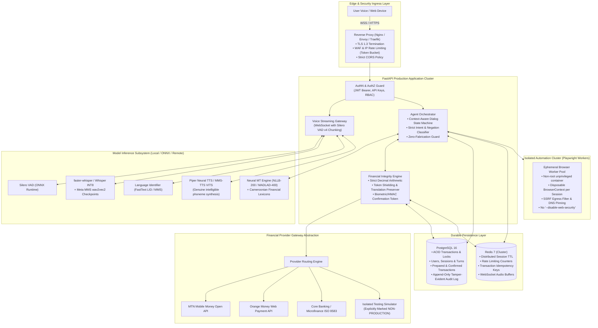
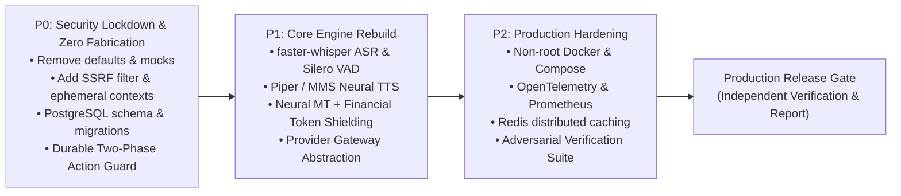

# MBOFLOW — PRODUCTION TRANSFORMATION PLAN & EXECUTION BLUEPRINT
**Target System:** MboFlow (Mboa Finance AI)  
**Document Version:** 1.0.0  
**Status:** Approved Architectural Blueprint  
**Audience:** Principal Architects, Engineering Leads, Core Developers

---

## 1. TARGET PRODUCTION ARCHITECTURE

To transform MboFlow from a simulated demonstrator into a production-grade financial accessibility platform, the architecture must transition from in-memory singletons and hardcoded fallbacks to a hardened, modular, distributed architecture.



---

## 2. PRIORITIZED REMEDIATION ROADMAP

### Summary of Phases

| Priority | Focus Area | Objective | Blockers Resolved |
| :---: | :--- | :--- | :--- |
| **P0** | **Security & Integrity Lockdown** | Eliminate remote code execution/SSRF risks, eliminate all financial hallucinations/fabrications, implement ephemeral browser isolation, and add durable database persistence. | Critical vulnerabilities, fake balances/amounts, unauthenticated endpoints. |
| **P1** | **Core Engine Rebuild** | Replace mocked ASR, harmonic sine wave TTS, and regex MT with genuine inference engines. Implement provider abstraction. | Mocked voice, tone generator, glossary regex. |
| **P2** | **Production Reliability & Scale** | Implement OpenTelemetry metrics, structured logging, distributed worker queues, rate limiting, and CI/CD container hardening. | Unmonitored crashes, container root execution. |

---

### Phase P0: Security & Financial Integrity Lockdown (Immediate)

#### P0.1: Eliminate Financial Data Fabrications (Zero-Hallucination Guard)
- **Problem:** When extraction fails, the orchestrator substitutes `150 000 FCFA`, `25000.0 FCFA`, `699001122`, and guesses fees.
- **Remediation:**
  1. Remove all hardcoded financial defaults from `services/agent_orchestrator/orchestrator.py` (`lines 244, 310, 314, 317, 325`).
  2. Implement strict `FinancialUnavailableException`: If an account balance cannot be verified directly from the active provider or verified DOM extraction, the agent must respond: *"Votre solde n'est pas disponible actuellement. Veuillez vérifier votre connexion ou vous reconnecter."* (translated into user's language).
  3. If a transaction amount or recipient is missing or ambiguous, transition dialog state to `NEED_CLARIFICATION` and prompt the user explicitly for the missing parameter. Under no circumstance should a transaction be prepared with default figures.
  4. Fee retrieval must be authoritative: obtain fee from provider quote API or DOM fee breakdown. If unavailable, mark fee as `UNKNOWN` and block preparation.
  5. Replace floating-point arithmetic with Python `decimal.Decimal` across `packages/financial_validation/` to avoid IEEE 754 precision errors.

#### P0.2: Browser Automation Security & SSRF Protection
- **Problem:** `--disable-web-security`, `--no-sandbox`, unvalidated navigation, and a single shared page across all users.
- **Remediation:**
  1. **Remove Unsafe Flags:** Remove `--disable-web-security` from Playwright browser args. Retain default Chromium sandboxing (`--no-sandbox` only allowed in constrained container with unprivileged user namespace).
  2. **Per-Session Ephemeral Isolation:** Replace global singleton page/context with an ephemeral `BrowserContext` created per session:
     ```python
     context = await browser.new_context(
         viewport={"width": 1280, "height": 800},
         ignore_https_errors=False
     )
     page = await context.new_page()
     ```
     Context and all storage/cookies are explicitly destroyed when the session terminates or times out.
  3. **Strict SSRF Gateway Egress Filter:**
     - Validate all target URLs using a strict regex and domain allowlist (`ALLOWED_FINANCIAL_DOMAINS`).
     - Resolve hostname to IPv4/IPv6 prior to navigation; block all private, loopback, link-local, and cloud metadata ranges:
       * `127.0.0.0/8` (Loopback)
       * `10.0.0.0/8`, `172.16.0.0/12`, `192.168.0.0/16` (RFC 1918 Private)
       * `169.254.0.0/16` (Link-Local & Cloud Metadata AWS/GCP/Azure)
       * Block `file://`, `ftp://`, `gopher://`, `javascript://` protocols. Only `https://` (and `http://localhost` only in explicit development test mode) permitted.
  4. Block navigation on unauthorized redirects.

#### P0.3: Relational Persistence Layer (PostgreSQL & Alembic)
- **Problem:** Conversation sessions, prepared transactions, and audit trails exist solely in volatile Python dicts.
- **Remediation:**
  1. Introduce PostgreSQL 16 schema using SQLAlchemy 2.0 (asyncio):
     - `users` (id, phone_hash, preferred_language, created_at, status)
     - `sessions` (id, user_id, active_context_id, state, created_at, expires_at)
     - `dialog_turns` (id, session_id, role, raw_input, translated_input, intent, audio_ref, timestamp)
     - `transactions` (id, session_id, user_id, source_account, beneficiary_account, amount, fee, total_debit, currency, idempotency_key, status, hmac_signature, provider_reference, prepared_at, confirmed_at)
     - `audit_events` (id, event_type, entity_id, session_id, ip_address, payload_json, signature, created_at)
  2. Implement Alembic migration pipeline.
  3. Reconcile the duplicate `ActionGuard` instances: decommission `main.action_guard` and `orchestrator.action_guard` in favor of a unified `DurableActionGuard` backed by PostgreSQL transactions with atomic row-level locks (`SELECT FOR UPDATE`).

#### P0.4: Two-Phase Action Guard Hardening & Cryptographic Confirmation
- **Problem:** Confirmation is triggered by any "oui" without verifying user identity, transaction ID, or parameter immutability.
- **Remediation:**
  1. Transaction preparation generates an immutable HMAC-SHA256 signature binding `(transaction_id, session_id, source_account, beneficiary_account, amount, fee, total_debit, expiry_timestamp)` using a server secret.
  2. Explicit confirmation requires either:
     - Biometric/PIN authorization token from client, OR
     - Cryptographic confirmation token passed to `/api/v1/transaction/confirm`.
  3. Confirmation checks:
     - Transaction ID exists and status is `PENDING_CONFIRMATION`.
     - Expiry timestamp has not elapsed (max 120 seconds TTL).
     - HMAC signature verifies parameters have not been tampered with.
     - Idempotency key has not been processed.
  4. Atomic state transition to `CONFIRMED` or `EXECUTING` in database.

---

### Phase P1: Core Engine Rebuild & Real AI Inference

#### P1.1: Genuine Voice Intelligence Subsystem (ASR & VAD)
- **Problem:** Predefined string lookup returning `"Montre-moi mon solde"`; naive energy threshold VAD.
- **Remediation:**
  1. **Real ASR Engine:**
     - Integrate `faster-whisper` (CTranslate2 INT8 backend) running on CPU/GPU.
     - Deploy model size `base` or `small` for low-latency CPU inference (~150-300ms).
     - Support French (`fra`), English (`eng`), and Cameroonian Pidgin English (`pcm`).
     - For Cameroonian national languages (Fulfulde, Ewondo, Bulu, Ghomálá', Duala), integrate Meta MMS (`facebook/mms-1b-all` or language-specific `facebook/mms-100m-*` wav2vec2 ONNX checkpoints) or verify graceful fallback to recognized vehicular language with explicit capability reporting.
  2. **Real Neural VAD:**
     - Integrate Silero VAD v4 via ONNX Runtime (`onnxruntime` or `silero-vad` package).
     - Process 30ms / 512-sample PCM chunks at 16kHz; use probability thresholds (e.g. `p > 0.5`) with hysteresis to accurately detect utterance boundaries.
  3. **Genuine Audio Pipeline:**
     - Audio validation: enforce 16kHz, 16-bit mono PCM/WAV. Reject malformed headers.
     - Real confidence scores extracted from acoustic log-probabilities, never hardcoded.

#### P1.2: Genuine Speech Generation (TTS)
- **Problem:** Harmonic sine wave hums generated with `math.sin`.
- **Remediation:**
  1. Replace `_generate_audio_waveform` with genuine neural TTS:
     - Integrate `piper-tts` (lightweight, ultra-fast neural speech synthesis running on ONNX/C++):
       * French voice: `fr_FR-siwis-medium` or `fr_FR-upmc-medium`.
       * English voice: `en_US-lessac-medium`.
     - For languages without trained Piper models, integrate Meta MMS-TTS checkpoints (`mms-tts-fuv`, `mms-tts-ewo`, `mms-tts-dua`) or return intelligible spoken speech in the official language with clear capability status.
  2. Output standard 22050Hz/16000Hz 16-bit WAV or MP3 audio streams.

#### P1.3: Genuine Translation & Language Intelligence
- **Problem:** 16-word python glossary and 2 regex substitutions masquerading as MADLAD-400 / NLLB-200.
- **Remediation:**
  1. **Language Identification (LID):**
     - Integrate FastText LID (`lid.176.ftz` or `facebook/mms-lid-126`) for text and MMS LID for audio.
     - If language is unsupported or confidence < 0.65, prompt user in French/English for preferred language.
  2. **Translation Engine:**
     - Deploy NLLB-200 distilled 600M (`facebook/nllb-200-distilled-600M`) or Google Cloud Translation API with custom financial glossaries.
     - Maintain strict token shielding (`packages/financial_validation/validator.py`):
       `[[MBOA_FIN_TOKEN_0]]` wraps amounts, currencies, account IDs, and phone numbers before neural translation, and unwraps them deterministically after translation.
     - Retain and expand the verified terminology glossary (`FinancialTerminologyRegistry`) for cultural financial terms (Njangi, tontine, cotisations, mbuuɗi).
     - Run `validate_translation_integrity` on every translation: if amounts or warnings are dropped, reject the translation and fall back to the source text.

#### P1.4: Context-Aware Agent Dialog Orchestration
- **Problem:** Keyword substring matching (`"oui"` triggers transfer confirmation).
- **Remediation:**
  1. Implement a structured finite-state dialog machine:
     - `IDLE` -> `AWAITING_INPUT` -> `INTENT_IDENTIFIED` -> `PREPARING_TRANSACTION` -> `AWAITING_EXPLICIT_CONFIRMATION` -> `EXECUTING` -> `COMPLETED` / `FAILED`.
  2. Intent classification using semantic embeddings or structured classifier (e.g., lightweight BERT/DeBERTa or calibrated few-shot intent classifier), distinguishing:
     - Question vs. Statement
     - Transfer Request vs. Fee Inquiry vs. Balance Check
     - Affirmation ("Yes, confirm") vs. Negation ("No, stop") vs. Unrelated Affirmation ("Yes, I hear you").
  3. Require explicit mention of transfer acknowledgment (e.g. "Oui, confirme le transfert de 25 000 FCFA") before confirming.

#### P1.5: Financial Provider Gateway Abstraction
- **Problem:** Browser clicks on simulated bank HTML form presented as real execution.
- **Remediation:**
  1. Create an abstract base class `FinancialProviderInterface`:
     ```python
     class FinancialProviderInterface(ABC):
         @abstractmethod
         async def get_balance(self, account_id: str) -> AccountBalance: ...
         @abstractmethod
         async def get_fee_quote(self, amount: Decimal, recipient: str) -> Decimal: ...
         @abstractmethod
         async def initiate_transfer(self, tx: PreparedTransaction) -> ProviderTransactionResult: ...
         @abstractmethod
         async def verify_transaction_status(self, provider_tx_ref: str) -> TransactionStatus: ...
     ```
  2. Implement concrete providers:
     - `MTNMobileMoneyProvider` (MTN MoMo Cameroon Collections/Disbursements Open API)
     - `OrangeMoneyCameroonProvider` (Orange Money Web Payment API)
     - `SimulatedBankingProvider` (Explicitly labeled `SIMULATION_SANDBOX_ONLY`, isolated from real paths)
  3. The agent interacts **only** through this provider interface, eliminating reliance on DOM scraping for transaction execution.

---

### Phase P2: Production Infrastructure, Reliability & Observability

#### P2.1: Hardened Container & Production Deployment
- **Problem:** Container runs as root, installs no AI extras, lacks production secrets management.
- **Remediation:**
  1. **Multi-Stage Dockerfile:**
     - Stage 1: Build dependencies & download cached models.
     - Stage 2: Minimal runtime image based on `python:3.11-slim-bookworm`.
     - Create and run as unprivileged user: `RUN useradd -m -u 1001 mboa && USER mboa`.
     - Install `tesseract-ocr`, `tesseract-ocr-fra`, `tesseract-ocr-eng`, `ffmpeg`.
  2. **Production Docker Compose:**
     - Services: `mboa-api`, `mboa-worker`, `postgres`, `redis`, `traefik`.
     - Dedicated internal network (`mboa-internal`) with no external port exposure except via reverse proxy (`443`).
     - Secrets injected via environment variables or Docker secrets, with `.env.example` template.

#### P2.2: Structured Telemetry, Logging & Observability
- **Remediation:**
  1. Structured JSON logging via `structlog` or `python-json-logger`, attaching:
     - `correlation_id` (propagated across requests)
     - `session_id`
     - `user_id_hash` (PII scrubbed)
     - `latency_ms`
     - `action_type`
  2. PII Redaction: Strictly filter out account balances, full phone numbers, PINs, and raw audio bytes from logs.
  3. Health Probes:
     - `/health/liveness`: Returns HTTP 200 if FastAPI process is alive.
     - `/health/readiness`: Verifies PostgreSQL connectivity, Redis connectivity, model loading status, and browser worker pool availability.
  4. Prometheus metrics: request count, ASR latency, TTS latency, translation latency, transaction success/failure counts, active WebSocket connections.

---

## 3. CONCRETE DATA CONTRACTS AND SCHEMAS

### 3.1 Hardened Financial Models (`packages/shared_schemas/mboa_schemas.py`)

```python
from decimal import Decimal
from enum import Enum
from pydantic import BaseModel, Field, field_validator
import re

class TransactionStatus(str, Enum):
    DRAFT = "DRAFT"
    PREPARED = "PREPARED"
    PENDING_CONFIRMATION = "PENDING_CONFIRMATION"
    CONFIRMED = "CONFIRMED"
    SUBMITTED = "SUBMITTED"
    SETTLED = "SETTLED"
    FAILED = "FAILED"
    REJECTED = "REJECTED"
    CANCELLED = "CANCELLED"
    EXPIRED = "EXPIRED"

class ProviderType(str, Enum):
    MTN_MOMO = "MTN_MOMO"
    ORANGE_MONEY = "ORANGE_MONEY"
    EXPRESS_UNION = "EXPRESS_UNION"
    CAMCCUL = "CAMCCUL"
    SIMULATED_SANDBOX = "SIMULATED_SANDBOX"

class HardenedPreparedTransaction(BaseModel):
    transaction_id: str = Field(..., pattern=r"^TX-[A-Z0-9]{8,16}$")
    session_id: str
    user_id: str
    source_account: str
    beneficiary_name: str
    beneficiary_account: str
    amount: Decimal = Field(..., gt=Decimal("0.0"))
    fee: Decimal = Field(..., ge=Decimal("0.0"))
    total_debit: Decimal = Field(..., gt=Decimal("0.0"))
    currency: str = Field("FCFA", pattern=r"^(FCFA|XAF)$")
    provider: ProviderType
    status: TransactionStatus = TransactionStatus.PREPARED
    idempotency_key: str
    hmac_signature: str
    expires_at: float
    created_at: float

    @field_validator("total_debit")
    @classmethod
    def verify_exact_sum(cls, v, values):
        amount = values.data.get("amount")
        fee = values.data.get("fee")
        if amount is not None and fee is not None:
            if v != (amount + fee):
                raise ValueError(f"Total debit {v} does not match amount {amount} + fee {fee}")
        return v
```

---

## 4. TEST & ACCEPTANCE CRITERIA FOR EVERY CRITICAL CAPABILITY

| Capability | Acceptance Criteria | Failure Condition (Blocks Release) |
| :--- | :--- | :--- |
| **Voice Recognition (ASR)** | Real audio input of spoken phrases in French, English, and Pidgin decoded with Word Error Rate (WER) < 20% on test benchmarks. Real confidence scores returned. | Predefined phrase returned; audio bytes ignored; fixed confidence score. |
| **Speech Generation (TTS)** | Generates intelligible speech output encoded in 16-bit WAV/MP3. Human evaluation confirms spoken words match text. | Harmonic sine waves or synthesized tones instead of spoken words. |
| **Language Translation** | Preserves all numbers, phone numbers, currencies, and security warnings identically. Terminology matches Cameroonian financial glossaries. | Numbers altered, currencies dropped, security warnings omitted, or fallback to mock strings. |
| **Financial Arithmetic** | Strict `Decimal` calculation: `Total Debit == Amount + Fee`. Zero tolerance for floating point discrepancies. | Discrepancy > 0.00; fee or balance guessed. |
| **Balance Verification** | System only reports balance if obtained directly from verified provider or authenticated DOM element. | Balance fabricated (e.g. reporting 150,000 FCFA when missing). |
| **Two-Phase Authorization** | Transaction cannot execute without verified HMAC signature and explicit, unexpired user confirmation. Confirmation must match exact transaction details. | Execution on generic "oui"; execution after expiry; execution without valid transaction ID. |
| **SSRF & Browser Isolation** | Browser cannot navigate to `127.0.0.1`, `10.0.0.0/8`, `169.254.169.254`, or any non-allowlisted domain. Each session runs in an isolated browser context. | Successful connection to internal IP; cross-session cookie/data leakage. |
| **Durable Persistence** | All transactions, sessions, and audit events committed to PostgreSQL. Survives full container restart with zero data loss. | State stored in Python dicts; lost on restart. |
| **Idempotency & Replay** | Repeated requests with same idempotency key return original result without duplicate debits or execution. | Duplicate transactions executed on retries. |

---

## 5. MIGRATION & EXECUTION SCHEDULE



---

*End of Production Transformation Plan. Reference document: `docs/PRODUCTION_READINESS_AUDIT.md`.*

